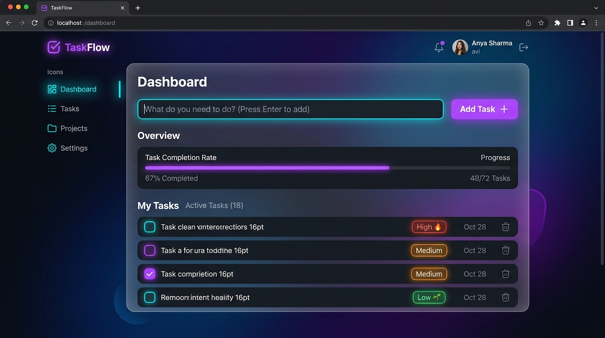

# TaskFlow &mdash; Modern Task Management

A modern, fast, and elegant Todo and Task Management web application built with vanilla HTML5, CSS3, and JavaScript.



## ✨ Features

- **Intuitive Task Creation**:
  - Add tasks via the **Add Task** button or simply by pressing <kbd>Enter</kbd> inside the input box.
  - Priority assignment: High 🔥, Medium, Low 🌱.
  - Category tagging: Work, Personal, Urgent, Learning, General.
- **Progress Tracking & Analytics**:
  - Live progress bar showing completion rate.
  - Stat counters for Total, Active, and Done tasks.
- **Interactive Management**:
  - Toggle completion with smooth animations.
  - Star / favorite critical tasks.
  - Inline / modal task editing (double-click or click edit icon).
  - Smooth removal with **Undo Toast notification**.
  - Confetti celebration when completing all tasks!
- **Search & Filter**:
  - Real-time search across task descriptions and categories.
  - Filter tabs: *All*, *Active*, *Done*, and *⭐ Starred*.
  - One-click *Clear Completed* batch action.
- **Themes & Sound**:
  - Sleek Dark Theme (default) and crisp Light Theme with persistent memory.
  - Dynamic Web Audio API sound feedback (toggleable).
- **Offline & Local**:
  - Automatically saves all state to `localStorage`. Zero server or build setup needed.

## 🚀 Getting Started

Simply open `index.html` in your favorite web browser!

Or serve locally with Python:

```bash
python -m http.server 3000
```

Then visit [http://localhost:3000](http://localhost:3000).

## ⌨️ Keyboard Shortcuts

| Shortcut | Action |
| --- | --- |
| <kbd>Enter</kbd> | Add task from input box |
| <kbd>/</kbd> | Quickly focus task input box |
| <kbd>Esc</kbd> | Close edit modal |
| Double Click | Edit any task in list |
